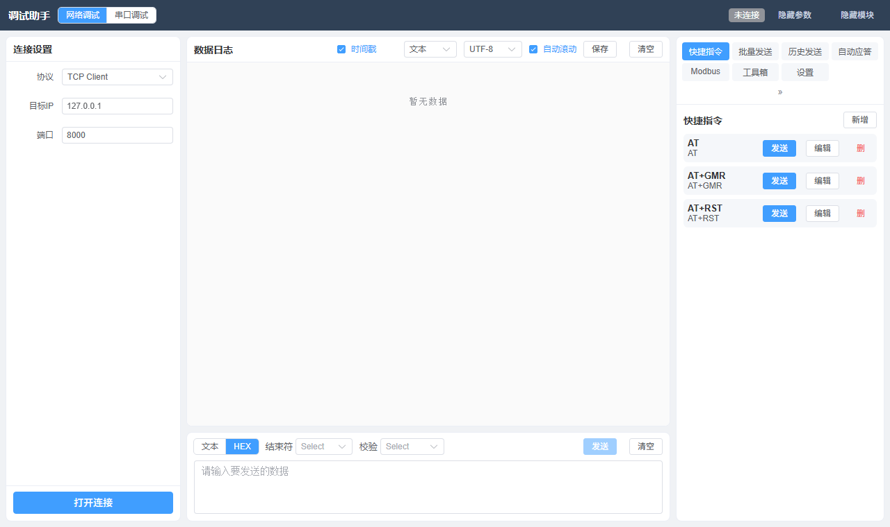
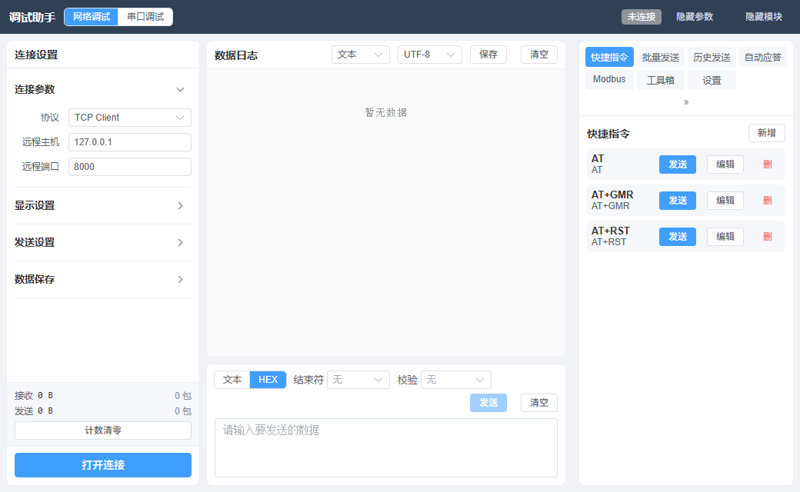

# 调试助手（Debug Assistant）

> Windows 桌面端网络 / 串口调试工具，NetAssist 风格。面向码头 / 泊位等工业现场调试场景：RS485 读设备、网络收发、HEX 报文、批量发指令、HTTP 服务端监听。

- **当前版本**：v1.3.1
- **形态**：单体 exe，双击即用（onedir / onefile 两种打包方式）
- **平台**：Windows 10 / 11 x64

---

## 功能特性

### 五大工作模式

| 模式 | 能力 |
|------|------|
| **网络调试** | TCP Client / TCP Server（多客户端管理）/ UDP，HEX 与文本收发 |
| **串口调试** | COM 端口收发，波特率/数据位/校验位/流控可配，CH340 实测通过 |
| **MQTT 调试** | Broker 连接、订阅 / 发布、主题着色、QoS、Retain，消息卡片展示 |
| **网络扫描** | 网段设备发现、厂商识别（内置 IEEE OUI 库）、统计与变化告警 |
| **HTTP Server** | 本机起 HTTP 服务端，接收任意 client 数据并实时查看 |

### 通用能力

- **HEX 默认**：发送 / 接收默认 HEX 展示，二进制报文自动识别
- **发送无长度上限**：1 字符到 300k+ 字符均可发送
- **多实例并行**：每实例从 20001 起自动扫描分配独立 API 端口，互不冲突
- **快捷指令 / 批量发送 / 历史发送 / 自动应答**：均可持久化，删掉后不会复活默认数据
- **日志保存**：文件名含时分秒（`debug_YYYYMMDD_HHMMSS.txt`），跨会话记忆上次目录
- **Modbus 帧构造**：常用功能码快速拼帧
- **内置工具箱**：编解码、进制转换、时间戳转换等

### 网络扫描（v1.3.1 增强）

- **统计口径**：`总占用 / 在线 / 离线 / 可用率 / 段内空`，并显示扫描段 CIDR
- **ARP 双读**（间隔 500ms）：避免 ARP 缓存未及时填充导致设备漏显
- **离线判定**：ARP 表有记录（曾通信过）但 TCP 无响应
- **变化告警**：与上一轮对比，输出 `本次新增 / 离开 / IP-MAC 变化（疑似 IP 冲突）`
- **收藏与备注**：★ 收藏置顶、按 IP 加备注、扫描历史，全部持久化
- **零第三方依赖**：仅标准库 `ipaddress` / `concurrent.futures` / `socket` / `ctypes`

### HTTP Server（v1.3.1 增强）

- 任意方法（`GET/POST/PUT/DELETE/PATCH/HEAD/OPTIONS`）、任意路径通吃
- 端口与绑定地址可配（默认 `8080` / `0.0.0.0`）
- 响应可配：**回显**（默认，client 发啥收啥）/ 自定义状态码、Content-Type、响应体 / 响应延迟
- 启动后展示所有可访问 URL（本机 + 局域网），一键复制
- **请求一键复制**：
  - 表格「来源」列：单独复制 IP 或端口
  - 表格最右「⧉」：复制整行
  - 详情区下拉：整条 JSON / **cURL 命令**（可直接复跑）/ URL / Body（文本）/ Body（HEX）/ Headers
- **零第三方依赖**：标准库 `http.server.ThreadingHTTPServer`

---

## 界面截图

| 调试主界面 | 布局与面板 |
|---|---|
|  |  |

> 更多截图见 `docs/screenshots/`

---

## 技术栈

| 层 | 技术 |
|---|---|
| 后端 | Python 3.13 + FastAPI + uvicorn |
| 桌面壳 | pywebview（WebView2） |
| 前端 | Vue 3 + Element Plus + Vite |
| 打包 | PyInstaller（onedir + onefile 双 spec） |
| 实时通道 | WebSocket（50ms 轮询 + 1s 心跳） |

**核心设计**：后端进程内起 uvicorn 提供 REST + WebSocket，pywebview 加载本地前端页面；
HTTP Server 模块使用独立的 `ThreadingHTTPServer` 线程，与主 API 服务完全隔离。

---

## 项目结构

```
.
├── netassist/
│   ├── backend/                      # Python 后端 + 桌面壳
│   │   ├── app.py                    # 桌面壳入口（端口扫描、窗口创建）
│   │   ├── main.py                   # FastAPI 应用与路由注册
│   │   ├── config.py                 # 全局配置（版本号、端口、上限）
│   │   ├── models.py                 # Pydantic 数据模型
│   │   ├── routes/                   # REST 路由（net / serial / mqtt / scan / http_server ...）
│   │   ├── services/                 # 业务服务（连接管理、扫描、HTTP Server ...）
│   │   ├── utils/                    # 工具（数据转换、网卡分类、ARP、厂商库）
│   │   ├── data/oui.txt              # 内置 IEEE OUI 厂商库
│   │   ├── static/                   # 前端构建产物（由 npm run build 生成）
│   │   ├── icon.ico                  # exe 图标
│   │   └── net-debug-tools*.spec     # PyInstaller 打包配置
│   ├── front/                        # Vue 3 前端源码
│   │   └── src/
│   │       ├── views/DebugView.vue   # 主界面（五大模式编排）
│   │       ├── components/           # 各模式面板组件
│   │       ├── api/index.js          # 后端接口封装
│   │       └── store.js              # 全局状态与持久化
│   ├── tests/                        # 端到端与单元测试脚本
│   └── scripts/                      # 辅助脚本（图标生成、交付同步）
├── docs/                             # 设计文档、UI 原型、测试报告、截图
└── README.md
```

---

## 快速开始

### 环境要求

- Python 3.11+
- Node.js 18+
- Windows 10 / 11（需要 WebView2 运行时；Win11 默认已装）

### 开发运行

```bash
# 1) 构建前端
cd netassist/front
npm install --registry=https://registry.npmmirror.com
npm run build              # 产物输出到 netassist/backend/static

# 2) 安装后端依赖
cd ../backend
python -m venv .venv
.venv/Scripts/pip install -r requirements.txt

# 3) 启动桌面程序
python app.py
```

> 仅调试后端接口时，可执行
> `python -m uvicorn main:app --host 127.0.0.1 --port 20001`，
> 然后访问 `http://127.0.0.1:20001/docs` 查看 API 文档。

### 打包为 exe

```bash
cd netassist/backend

# onedir（推荐：启动快，依赖外置）
python -m PyInstaller net-debug-tools.spec --noconfirm

# onefile（单文件，便于分发）
python -m PyInstaller net-debug-tools-onefile.spec --noconfirm \
  --distpath dist_onefile --workpath build_onefile
```

**注意**：不要使用 `--clean`；打包前请先把旧的 `dist` 移走并新建空目录。

---

## 使用要点

### 网络扫描

切换到「网络扫描」模式 → 左栏选网段 → 开始扫描。完成后中栏顶部显示统计 chip 与变化告警。

- **总占用** = 在线 + 离线；**可用率** = 总占用 / 扫描地址总数
- 「离线」指 ARP 表有记录（曾通信过）但本次 TCP 无响应；常见原因：设备休眠 / 端口全关 / 跨网段被路由隔离

### HTTP Server

切换到「HTTP Server」模式 → 设置端口与绑定地址 → 启动服务。

> **⚠️ 首次启动监听 `0.0.0.0` 时，Windows 防火墙会弹出「是否允许访问」提示，必须点击「允许访问」，局域网内其他机器才能连入。**

- 保留端口段 `20001~20050` 为本程序自用 API 端口，不可作为监听端口
- 同一时刻仅运行一个 HTTP Server 实例

---

## 常见问题

**Q：双击 exe 没反应？**
A：确认 `_internal/` 与 exe 在同一目录；查看同目录 `startup.log` 排查。

**Q：局域网内其他机器连不上 HTTP Server？**
A：① 绑定地址选 `0.0.0.0`；② 放行 Windows 防火墙入站提示；③ 确认对方与本机同一网段。

**Q：能同时监听多个 HTTP 端口吗？**
A：启动多个程序实例即可（每个实例会自动分配独立 API 端口）。

**Q：扫描为什么有「离线」设备？**
A：详见上方「网络扫描」小节。

---

## 版本历史

| 版本 | 内容 |
|---|---|
| **v1.3.1** | HTTP Server 请求一键复制（含 cURL）；扫描新增 总占用/在线/离线/可用率/段内空 统计 + 变化告警；修复「解析主机名」开关不生效 |
| v1.3.0 | 新增 HTTP Server 模块（第五模式） |
| v1.2.0 | 新增 MQTT 调试 + 网络扫描 |
| v1.0.0 | 网络 + 串口 + Modbus 帧 + 快捷指令 |

---

## 设计文档

| 文档 | 说明 |
|---|---|
| `docs/项目总结.md` | 项目整体总结 |
| `docs/网络扫描模块设计方案.md` | 扫描模块设计（功能池、技术方案、风险） |
| `docs/HTTP_Server模块设计方案.md` | HTTP Server 模块设计 |
| `docs/MQTT功能实施计划书.md`、`docs/设计-MQTT增量.md` | MQTT 模块设计 |
| `docs/http_server_ui_preview.html` | HTTP Server 可交互 UI 原型 |
| `docs/测试报告-*.md` | 各模块测试报告 |

---

## 数据存储

用户配置（快捷指令 / 扫描收藏 / HTTP Server 配置 / 主题等）保存在：

```
%LOCALAPPDATA%\调试助手\store.json
```

如需重置，删除该文件后重启程序。

---

## 免责说明

本项目为内部调试工具，仅供授权的网络与设备调试使用。请勿用于未经授权的网络探测或扫描。
