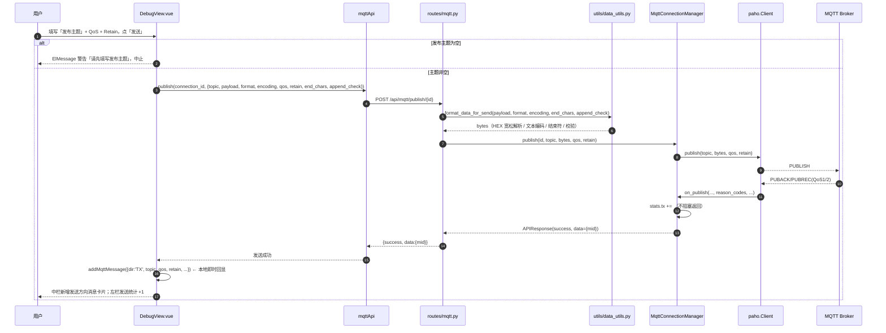
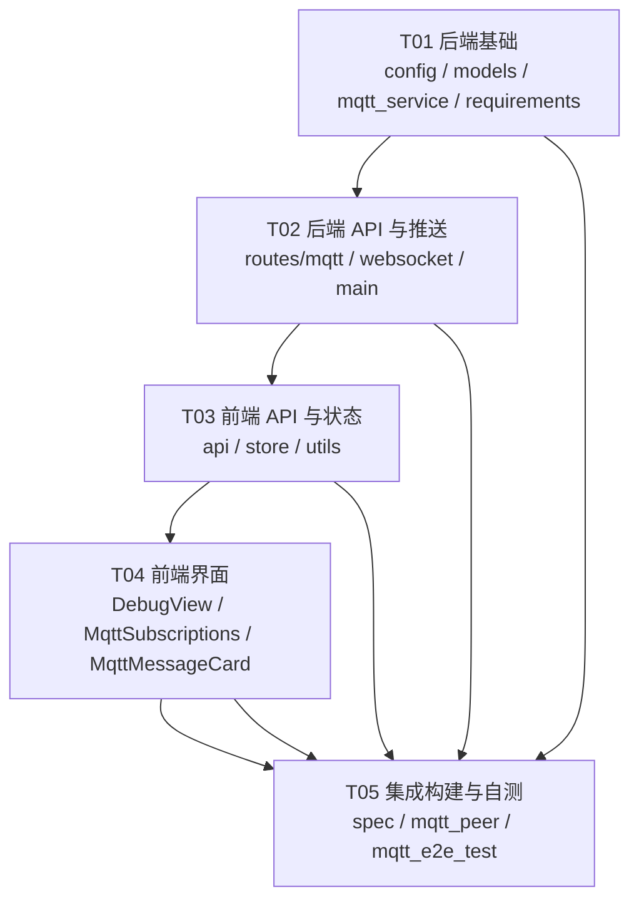

# 设计 · MQTT 收发功能（增量）

> 产品：调试助手（Debug Assistant）· 桌面端网络/串口/MQTT 调试工具
> 版本：v1.0.0 → v1.1.0（本次增量）
> 文档类型：**增量架构设计 + 任务分解**（仅描述本次变更，不重述系统全貌）
> 撰写：架构师 高见远
> 日期：2026-10-14
> 依据：`docs/PRD-MQTT增量.md`、`docs/MQTT功能实施计划书.md`、`docs/ui_preview_v3.html`、现有源码 `netassist/backend/*` 与 `netassist/front/src/*`

---

## Part A：系统设计

### 1. 实现方案概述

本次增量在现有「网络调试 / 串口调试」两个模式之外，新增独立第三模式「MQTT调试」，一期仅核心收发（连接 / 订阅 / 接收 / 发布），**不改动网络与串口的任何现有逻辑**。

#### 1.1 核心难点

| 难点 | 说明 | 对策 |
|---|---|---|
| 交互模型差异 | TCP/UDP/串口是「字节流」，MQTT 是「发布/订阅」：发送必须带 Topic+QoS+Retain，接收必须知道来源 Topic | 独立第三模式承载专属参数；发送区新增「发布主题」行；接收改用「消息卡片」 |
| 多开实例互踢 | 两个实例用相同 ClientID 连同一 Broker 会互相踢线 | ClientID 默认自动生成 `debug-assistant-<8位随机>`，用户可覆盖；提供「重连追加时间戳」开关 |
| paho-mqtt 2.x 回调 API 变更 | 不显式传 `CallbackAPIVersion.VERSION2` 直接抛 `ValueError`，且回调签名全变 | 统一 VERSION2，按官方迁移表实现回调（见 §5 回调表） |
| 路由被 SPA catch-all 吞 | `main.py` 中 `/{path:path}` 会吞掉后注册的路由 | `mqtt_router` 必须在 catch-all 之前注册 |
| 断线重连恢复订阅 | 现场网络抖动后需自动恢复 | 本地维护订阅表，`on_connect` 无条件重放（对齐 MQTTX `autoResub`） |
| PyInstaller 收集 paho | 打包需收集 paho 子模块 | spec 增加 `collect_submodules('paho')`；**不加 `--clean`** |

#### 1.2 技术选型

| 层 | 选型 | 理由 |
|---|---|---|
| MQTT 客户端库 | `paho-mqtt>=2.1.0` | 纯 Python 包、无编译器/DLL 依赖、PyInstaller 友好、官方维护；与现有 FastAPI 后端同进程便于复用 WS 推送 |
| 后端框架 | 沿用 FastAPI + uvicorn | 复用现有 REST + WebSocket 体系 |
| 协议版本 | MQTT **3.1.1**（固定，一期不暴露切换） | 现场设备与 Broker 兼容性最广 |
| 前端 | 沿用 Vue3 + Element Plus + 现有 store/api 体系 | 复用三栏骨架、统一按钮体系、持久化机制 |
| 数据推送 | **完全复用现有「50ms 轮询后端队列 + 1s heartbeat」WS 模式** | 前端实时模型与网络/串口一致，降低认知与维护成本 |

#### 1.3 MQTT 数据流

```
连接：  前端 POST /api/mqtt/connect ──► MqttConnectionManager.connect(config)
                                         ├─ 生成/采用 client_id
                                         ├─ paho.Client(CallbackAPIVersion.VERSION2, client_id)
                                         ├─ username_pw_set() / reconnect_delay_set()
                                         ├─ user_data_set(connection_id)  ← 回调据此定位连接
                                         ├─ client.connect(host, port, keepalive)  ← 同步建链，失败即抛
                                         ├─ client.loop_start()
                                         └─ 等待 connack_event（最长 10s）→ 记录连接结果

订阅：  前端 POST /api/mqtt/subscribe/{id} ──► 记入订阅表 + client.subscribe(topic, qos)
                                              └─ on_subscribe 更新状态（reason_codes>=128 为失败）

接收：  Broker ──► on_message(client, userdata, msg)   ← 签名不变
                     ├─ 原始 payload 保留 bytes，入 conn["queue"]（deque, maxlen=5000）
                     ├─ 匹配订阅表，订阅项消息数 count += 1
                     └─ stats.receive_bytes/receive_count +=
        WS /ws/mqtt/{id} 50ms 轮询 read_data() ──► 前端 addMqttMessage({dir:'RX', topic, qos, retain})

发布：  前端 POST /api/mqtt/publish/{id} ──► format_data_for_send() 复用现有 HEX/文本/结束符/校验
                                             └─ client.publish(topic, payload, qos, retain)
                                                └─ stats.send_bytes/send_count +=
        （前端本地立即 addMqttMessage({dir:'TX', ...})，不等 on_publish，避免发送体感延迟）

重连：  paho loop 自动重连 ──► on_connect 再次触发 ──► 无条件重放订阅表，恢复订阅关系
```

**如何复用现有 WS 轮询模式**：`/ws/mqtt/{connection_id}` 与 `/ws/net/{connection_id}` 结构完全一致——50ms `asyncio.sleep` 轮询 + `asyncio.to_thread(mgr.read_data, id)` 取数据 + 1s 无数据时发 heartbeat。差异仅在于：`read_data` 返回的是 `(topic, payload_bytes, qos, retain)` 四元组而非 `(client_id, data)`，且 data 帧多携带 `topic/qos/retain` 字段。这样前端 WS 连接、断线处理、暂停显示、统计累加均可复用现有代码路径。

---

### 2. 文件清单

> 路径均相对仓库根 `netassist/`。标注「新增」/「修改」。

#### 2.1 后端

| 文件 | 状态 | 职责 |
|---|---|---|
| `backend/requirements.txt` | 修改 | 新增依赖 `paho-mqtt>=2.1.0` |
| `backend/config.py` | 修改 | 新增 MQTT 默认常量（默认 Broker/端口/心跳/连接超时/重连周期/队列上限/ClientID 前缀） |
| `backend/models.py` | 修改 | 新增 `MqttConfig` / `MqttSubscribeRequest` / `MqttUnsubscribeRequest` / `MqttPublishRequest` Pydantic 模型 |
| `backend/services/mqtt_service.py` | **新增** | `MqttConnectionManager`：paho 客户端生命周期、订阅表、消息队列、统计、回调实现 |
| `backend/routes/mqtt.py` | **新增** | MQTT REST 路由（connect/disconnect/publish/subscribe/unsubscribe/subscriptions/status） |
| `backend/routes/websocket.py` | 修改 | 新增 `/ws/mqtt/{connection_id}` 端点（复用 50ms 轮询 + 1s heartbeat） |
| `backend/main.py` | 修改 | 导入并注册 `mqtt_router`，**必须置于 `/{path:path}` catch-all 之前** |
| `backend/net-debug-tools.spec` | 修改 | `hiddenimports` 增加 `collect_submodules('paho')`；打包**不加 `--clean`** |

#### 2.2 前端

| 文件 | 状态 | 职责 |
|---|---|---|
| `front/src/api/index.js` | 修改 | 新增 `mqttApi`（connect/disconnect/publish/subscribe/unsubscribe/getSubscriptions/getStatus/createWebSocket） |
| `front/src/store.js` | 修改 | 新增持久化 key `mqttConfig` / `mqttSubscriptions`；新增 `mqttMessages` / `pendingMessages` 运行时态；新增 `addMqttMessage` / `flushPendingMessages` / `clearMqttMessages` / `resetMqttCounts` / `topicColor()` |
| `front/src/utils.js` | 修改 | 新增 `TOPIC_COLOR_POOL`（8 色）、`hexToRgba()`、`matchTopic(actual, pattern)`（`+`/`#` 通配符匹配） |
| `front/src/views/DebugView.vue` | 修改 | ①顶部模式组加 `mqtt`；②左栏 `mode==='mqtt'` 参数分支；③中栏连接信息条 + 消息卡片列表；④发送区「发布主题」行；⑤右栏 `modules` 动态增删「订阅」Tab；⑥`toggleConnect`/`connect`/`disconnect`/`doSend`/`onWsMessage` 增加 mqtt 分支 |
| `front/src/components/MqttSubscriptions.vue` | **新增** | 订阅管理面板：新增订阅行、订阅卡片列表（色条/主题/QoS/消息数/设为默认/取消）、空状态 |
| `front/src/components/MqttMessageCard.vue` | **新增** | 单条 MQTT 消息卡片：时间、主题标签（色点 + 10% 底色）、QoS 徽标、Retain 徽标、方向、payload |

#### 2.3 测试

| 文件 | 状态 | 职责 |
|---|---|---|
| `tests/mqtt_peer.py` | **新增** | 独立对端脚本（用 paho 独立进程订阅/发布），用于验证 HEX 字节一致性、中文、QoS、Retain、通配符 |
| `tests/mqtt_e2e_test.py` | **新增** | 端到端联调脚本：连接公共 Broker → 订阅 → 对端发布 → 校验接收；HEX/文本/QoS/重连恢复订阅 |

---

### 3. 数据结构与接口

#### 3.1 后端 Pydantic 模型（`models.py` 新增）

```python
class MqttConfig(BaseModel):
    """MQTT 连接配置（一期仅 3.1.1，不含 TLS/遗嘱/WS 字段）"""
    host: str = "broker.emqx.io"
    port: int = 1883
    client_id: str = ""            # 空 → 后端自动生成 debug-assistant-<8位hex>
    username: str = ""
    password: str = ""
    keepalive: int = 60            # 秒
    clean: bool = True             # Clean Session
    mqtt_version: str = "3.1.1"    # 一期固定，UI 不暴露
    reconnect: bool = True         # 自动重连
    reconnect_period: int = 4000   # ms
    client_id_with_time: bool = False  # 重连时在 ClientID 追加时间戳，规避多开冲突


class MqttPublishRequest(BaseModel):
    """MQTT 发布请求（发送格式/结束符/校验复用现有 data_utils）"""
    topic: str
    payload: str = ""
    format: str = "hex"            # text / hex（沿用现有默认 HEX）
    encoding: str = "utf-8"        # utf-8 / gbk
    qos: int = 0                   # 0 / 1 / 2
    retain: bool = False
    end_chars: str = ""            # "" / "\n" / "\r\n"
    append_check: Optional[str] = None  # sum / xor / lrc / crc16 / fcs


class MqttSubscribeRequest(BaseModel):
    topic: str
    qos: int = 0                   # 0 / 1 / 2


class MqttUnsubscribeRequest(BaseModel):
    topic: str
```

#### 3.2 `MqttConnectionManager` 类方法签名（`services/mqtt_service.py` 新增）

```python
class MqttConnectionManager:
    def __init__(self) -> None: ...
    def _gen_client_id(self) -> str:
        """生成 debug-assistant-<8位随机十六进制>"""

    def connect(self, config: MqttConfig) -> APIResponse:
        """建链：client_id 处理 → paho.Client(VERSION2, client_id) → 设回调
        → username_pw_set（有则设）→ reconnect_delay_set → user_data_set(connection_id)
        → client.connect(host, port, keepalive) 同步建链（失败即返回 False）
        → client.loop_start() → 等 connack_event 最长 10s
        返回 APIResponse(success, message, data={connection_id, client_id})"""

    def disconnect(self, connection_id: str) -> APIResponse:
        """置 manual_disconnect=True → client.disconnect() → client.loop_stop()
        → 清资源，从 connections 移除；订阅表随连接销毁（持久化由前端负责）"""

    def publish(self, connection_id: str, topic: str,
                payload: bytes, qos: int, retain: bool) -> APIResponse:
        """client.publish(topic, payload, qos, retain)；更新 stats；返回 data={mid}
        注意：仅入队成功即返回，不阻塞等待 ACK（与 AC-06 字节一致性无关，字节由 payload 决定）"""

    def subscribe(self, connection_id: str, topic: str, qos: int) -> APIResponse:
        """写入订阅表（state='pending', count=0）→ client.subscribe(topic, qos)
        → on_subscribe 回调置 state='subscribed'/'failed'"""

    def unsubscribe(self, connection_id: str, topic: str) -> APIResponse:
        """client.unsubscribe(topic) → 从订阅表移除"""

    def get_subscriptions(self, connection_id: str) -> List[dict]:
        """返回 [{topic, qos, state, count}]（count 为该订阅命中的消息数）"""

    def read_data(self, connection_id: str) -> Optional[Tuple[str, bytes, int, bool]]:
        """从队列取一条：(topic, payload_bytes, qos, retain)；无数据返回 None（供 WS 轮询）"""

    def get_status(self, connection_id: str) -> Optional[dict]:
        """返回 {connected, host, port, client_id, stats, subscriptions:[{topic,qos,state,count}]}"""

    def get_connection(self, connection_id: str) -> Optional[dict]:
        """返回连接内部 dict（供 WS 端点判断存在性与心跳取值）"""
```

**连接内部 dict 结构**（`self.connections[connection_id]`）：

```python
{
  "client": mqtt.Client,                # paho 客户端
  "config": dict,                       # MqttConfig 序列化
  "connected": bool,
  "connack_event": threading.Event,     # connect() 同步等待 CONNACK
  "connect_error": Optional[str],       # CONNACK 拒绝时的人类可读原因
  "manual_disconnect": bool,            # 区分主动断开 vs 异常掉线
  "stats": {"receive_bytes","receive_count","send_bytes","send_count","error_count"},
  "queue": collections.deque(maxlen=5000),
  "subscriptions": {                    # {topic: {...}}
     "<topic>": {"qos": int, "state": "pending|subscribed|failed", "count": int}
  },
}
```

**paho-mqtt 2.x VERSION2 回调签名与职责（实现要点）：**

| 回调 | VERSION2 签名 | 职责 |
|---|---|---|
| `on_connect` | `(client, userdata, flags, reason_code, properties)` | `reason_code == 0` → `connected=True`、`connect_error=None`、**无条件重放订阅表**、`connack_event.set()`；否则记录 `connect_error`（如「ClientID 被占用 / Identifier rejected」文案映射）并 `connack_event.set()` |
| `on_disconnect` | `(client, userdata, flags, reason_code, properties)` | `connected=False`；若 `manual_disconnect` 为 False 记为异常掉线（前端心跳体现） |
| `on_message` | `(client, userdata, msg)`（不变） | payload 保留原始 `bytes` 入队；匹配订阅表累加 count；`stats.receive_* +=` |
| `on_subscribe` | `(client, userdata, mid, reason_codes, properties)` | 订阅表 state 置为成功 / `reason_codes >= 128` 置 failed |
| `on_publish` | `(client, userdata, mid, reason_codes, properties)` | QoS1/2 送达确认（仅记录，不阻塞发送返回） |

> `userdata` 统一设为 `connection_id`，回调内通过 `mqtt_manager.get_connection(userdata)` 定位连接。

#### 3.3 REST 接口表（`routes/mqtt.py`，prefix=`/api/mqtt`）

| 方法 | 路径 | 请求体 | 响应（`APIResponse` 形态） |
|---|---|---|---|
| POST | `/api/mqtt/connect` | `MqttConfig` | `{success, message, data:{connection_id, client_id}, connection_id}`；失败返回 400 |
| POST | `/api/mqtt/disconnect/{connection_id}` | 无 | `{success, message}` |
| POST | `/api/mqtt/publish/{connection_id}` | `MqttPublishRequest` | `{success, message, data:{mid}}` |
| POST | `/api/mqtt/subscribe/{connection_id}` | `MqttSubscribeRequest` | `{success, message, data:{topic, qos}}` |
| POST | `/api/mqtt/unsubscribe/{connection_id}` | `MqttUnsubscribeRequest` | `{success, message}` |
| GET | `/api/mqtt/subscriptions/{connection_id}` | 无 | `{success, data:{subscriptions:[{topic,qos,state,count}]}}` |
| GET | `/api/mqtt/status/{connection_id}` | 无 | `{connected, host, port, client_id, stats, subscriptions}`（不存在返回 `{connected:false}`） |

> 路径参数 `connection_id` 与现有 `net`/`serial` 路由风格保持一致（`/{connection_id}` 置于路径末段）。前端每实例单连接，`connection_id` 一次连接内固定。

#### 3.4 WebSocket 消息体 JSON Schema（`/ws/mqtt/{connection_id}?encoding=utf-8`）

**数据帧**：
```json
{
  "type": "data",
  "connection_id": "mqtt:broker.emqx.io:1883",
  "topic": "berth/sensor/001",
  "data": "…文本（按 encoding 解码，errors=ignore）…",
  "hex_data": "01 03 04 00 1A 00 2B 8C 4E",
  "qos": 0,
  "retain": false,
  "length": 8,
  "timestamp": 1728870123.456
}
```

**心跳帧**（无数据满 1s 发送）：
```json
{
  "type": "heartbeat",
  "data": {
    "connectionId": "mqtt:broker.emqx.io:1883",
    "status": "connected",
    "host": "broker.emqx.io",
    "port": 1883,
    "clientId": "debug-assistant-a3f91c2b",
    "stats": {"receive_bytes":0,"receive_count":0,"send_bytes":0,"send_count":0,"error_count":0},
    "subscriptions": [{"topic":"berth/sensor/+","qos":0,"state":"subscribed","count":12}]
  },
  "timestamp": 1728870123.456
}
```

**错误帧**（连接不存在 / 连接丢失，与 net 端点一致）：
```json
{ "type": "error", "message": "连接不存在", "timestamp": 1728870123.456 }
```

> 说明：接收侧 payload 由后端 `format_received_data(data, encoding)` 生成 `text`/`hex`/`length`；`hex_data` 为原始字节的 HEX（空格分隔、大写），前端 HEX/文本显示切换与其一致。`qos`/`retain` 为新增字段，供消息卡片徽标渲染。

#### 3.5 前端 `mqttApi` 方法签名（`api/index.js` 新增）

```js
export const mqttApi = {
  async connect(config) { /* POST /mqtt/connect，body=config，返回 {connection_id, client_id} */ },
  async disconnect(connectionId) { /* POST /mqtt/disconnect/{id} */ },
  async publish(connectionId, payload = {}) {
    /* POST /mqtt/publish/{id}
       body: { topic, payload, format, encoding, qos, retain, end_chars, append_check } */
  },
  async subscribe(connectionId, topic, qos = 0) { /* POST /mqtt/subscribe/{id} */ },
  async unsubscribe(connectionId, topic) { /* POST /mqtt/unsubscribe/{id} */ },
  async getSubscriptions(connectionId) { /* GET /mqtt/subscriptions/{id} */ },
  async getStatus(connectionId) { /* GET /mqtt/status/{id} */ },
  createWebSocket(connectionId, encoding, onMessage, onClose, onError) {
    /* new WebSocket(`${WS_BASE_URL}/mqtt/${connectionId}?encoding=${encoding||'utf-8'}`)
       与 serialApi.createWebSocket 同构 */
  }
}
```

#### 3.6 `store.js` 新增持久化 key 与运行时态

**新增持久化 key（并入 `PERSIST_KEYS`，随既有本机数据文件+localStorage 双写）：**

```js
// PERSIST_KEYS 追加：'mqttConfig', 'mqttSubscriptions'

store.mqttConfig = load('na_mqtt_config', {
  host: 'broker.emqx.io',
  port: 1883,
  clientId: '',            // 空则由后端生成唯一 ClientID
  username: '',
  password: '',
  clean: true,
  reconnect: true,
  keepalive: 60,
  clientIdWithTime: false,
  // —— 发送区随带状态（一并持久化，符合"跨天作业不重配"）——
  publishTopic: '',        // 发布主题（设为默认即写此字段）
  publishQos: 0,
  publishRetain: false
})

// 订阅列表：持久化 {topic, qos, color}；count 为运行时，不持久化（重启归零）
store.mqttSubscriptions = load('na_mqtt_subs', [])
//   [{ topic: 'berth/sensor/+', qos: 0, color: '#2f6fed', count: 12 }]
```

**新增运行时态（不持久化）：**

```js
store.mqttMessages = []      // 消息卡片数据源，元素见 §3.6.1，上限 2000
store.pendingMessages = []   // 暂停显示期间堆积的 MQTT 消息，恢复时合并
store.topicColorMap = {}     // { topic: color } 会话内主题→颜色登记表（R-08 一致性）
store.mqttConnInfo = { connected:false, host:'', port:0, clientId:'', status:'disconnected' }
```

**新增导出函数：**

```js
export function addMqttMessage(msg, paused = false)  // 累加 stats（复用 byteSize）+ 入 mqttMessages 或 pendingMessages
export function flushPendingMessages()               // pendingMessages → mqttMessages，返回合并条数
export function clearMqttMessages()                  // 清空 mqttMessages + pendingMessages
export function topicColor(topic)                    // 首次出现按 TOPIC_COLOR_POOL 顺序分配并登记
```

> **§3.6.1 `mqttMessages` 单元素结构**：
> ```js
> {
>   dir: 'RX' | 'TX' | 'AUTO',
>   topic: 'berth/sensor/001',
>   qos: 0,
>   retain: false,
>   text: '<解码文本>',
>   hex: '01 03 04 00 1A 00 2B 8C 4E',
>   time: 1728870123.456,       // 秒
>   timeStr: '10:31:02.114',
>   display: '<按 recvFormat 计算的显示串>'
> }
> ```

**持久化监听新增（沿用现有 watch 机制）：**
```js
watch(() => store.mqttConfig, (v) => { save('na_mqtt_config', v); scheduleRemoteSave() }, { deep: true })
watch(() => store.mqttSubscriptions, () => { save('na_mqtt_subs', store.mqttSubscriptions.map(({topic,qos,color}) => ({topic,qos,color}))); scheduleRemoteSave() }, { deep: true })
```
> 写入 localStorage 与远端时**剥离 `count`**，避免运行时计数污染持久化数据。

---

### 4. 程序调用流程

#### 4.1 连接 → 订阅 → 接收 → 推送前端

```mermaid
sequenceDiagram
    autonumber
    participant U as 用户
    participant V as DebugView.vue
    participant API as mqttApi
    participant R as routes/mqtt.py
    participant M as MqttConnectionManager
    participant P as paho.Client
    participant B as MQTT Broker
    participant W as routes/websocket.py

    U->>V: 点「打开连接」(MQTT 模式)
    V->>API: connect(mqttConfig)
    API->>R: POST /api/mqtt/connect
    R->>M: connect(config)
    M->>M: client_id 为空则生成 debug-assistant-<8hex>
    M->>P: Client(VERSION2, client_id)
    M->>P: user_data_set(connection_id)
    M->>P: connect(host, port, keepalive)
    P-->>B: TCP + CONNECT
    M->>P: loop_start()
    B-->>P: CONNACK
    P->>M: on_connect(..., reason_code, ...)
    Note over M: connected=True; connack_event.set()
    R->>P: subscribe(订阅表各项)  (重放)
    M-->>R: APIResponse(connection_id, client_id)
    R-->>API: {success, data:{connection_id, client_id}}
    API-->>V: 连接成功
    V->>API: createWebSocket(connection_id)
    API->>W: WS /ws/mqtt/{id}

    U->>V: 右栏「订阅」输入主题+qos，点「订阅」
    V->>API: subscribe(connection_id, topic, qos)
    API->>R: POST /api/mqtt/subscribe/{id}
    R->>M: subscribe(id, topic, qos)
    M->>P: subscribe(topic, qos)
    P-->>B: SUBSCRIBE
    B-->>P: SUBACK
    P->>M: on_subscribe(..., reason_codes, ...)
    Note over M: 订阅表 state=subscribed
    M-->>V: success（前端写入 store.mqttSubscriptions）

    B-->>P: PUBLISH(匹配订阅)
    P->>M: on_message(client, userdata, msg)
    M->>M: queue.append((topic, payload, qos, retain)); stats.rx += ; 订阅 count++
    loop 每 50ms
        W->>M: asyncio.to_thread(read_data, id)
        M-->>W: (topic, payload, qos, retain) 或 None
    end
    W->>W: format_received_data(payload, encoding)
    W-->>API: WS data 帧(type=data, topic, hex_data, qos, retain, ...)
    API-->>V: onMessage(msg)
    V->>V: addMqttMessage({dir:'RX', topic, qos, retain, ...}, paused)
    V->>V: topicColor(topic) 着色 + 订阅命中计数渲染
    V-->>U: 中栏「消息记录」新增消息卡片
```

#### 4.2 前端发布 → Broker



---

### 5. 补充设计说明

#### 5.1 前端模式切换与右栏「订阅」Tab 逻辑（对应 AC-01）

- `modules` 由静态数组改为 `computed`：基础 7 项 + 当 `mode==='mqtt'` 时在「自动应答」后插入 `{key:'sub', label:'订阅', short:'订阅'}`。
- 进入 MQTT 模式：`activeModule` 默认切到 `'sub'`。
- 离开 MQTT 模式：若 `activeModule==='sub'` 则切回 `'quick'`；若有连接则自动 `disconnect()`（与现有 `watch(mode)` 一致）。
- 中栏工具栏标题：MQTT 模式显示「消息记录」，其余显示「数据日志」。

#### 5.2 暂停显示（R-13 / AC-15）

复用现有 `store.settings.pauseDisplay`。MQTT 模式下列表不新增卡片、仅 `pendingMessages` 堆积并累加统计；`togglePauseDisplay` 恢复时同时 `flushPendingLines()` 与 `flushPendingMessages()`，按钮显示待显示条数（`pendingMessages.length`）。

#### 5.3 循环发送（R-17）

复用现有 `loopSending` / `loopInterval` / `loopTimer`，MQTT 模式下 `doSend()` 走 mqtt 分支，按「发布主题」发布当前发送框内容。

#### 5.4 多开 ClientID（R-09 / AC-11）

- `MqttConfig.client_id` 为空时后端生成 `debug-assistant-<8位随机hex>`；连接响应回传实际使用值，前端连接信息条显示之。
- `client_id_with_time=True` 时，重连成功前在 client_id 追加 `-<epoch秒>`（对齐 MQTTX `clientIdWithTime`）。
- `on_connect` 收到非 0 `reason_code`（如 Identifier rejected / 5）时，`connect_error` 记录并映射为「ClientID 被占用，请更换」文案，`/api/mqtt/connect` 返回 400。

#### 5.5 断线重连恢复订阅（R-10 / AC-12）

paho `loop_start()` 内置自动重连（`reconnect_delay_set(reconnect_period/1000, max)`），仅当 `config.reconnect=True` 时启用；`on_connect` 每次成功（含重连）都无条件重放 `connections[id]["subscriptions"]`。前端无需额外逻辑，心跳帧恢复 `status='connected'`。

#### 5.6 订阅持久化与重启恢复（R-11 / AC-13）

订阅表持久化于前端（`store.mqttSubscriptions`，随既有本机文件机制）。重启后：软件恢复订阅列表 UI；点「打开连接」连接成功后，前端**逐条调用 `mqttApi.subscribe`** 重建订阅关系（等价于后端重放的镜像）。

#### 5.7 打包（AC-17）

`net-debug-tools.spec` 的 `hiddenimports` 增加：
```python
from PyInstaller.utils.hooks import collect_submodules
hidden_imports.extend(collect_submodules('paho'))
```
先 `npm run build`（输出到 `backend/static`），再 PyInstaller 重打包（**不加 `--clean`**），打包后校验 `_internal/paho` 目录存在并实连 Broker 收发一轮。

---

### 6. Anything UNCLEAR（待明确事项）

- **无**。PRD 第 8 节明确「待确认问题：无」，产品决策（UI 组织 / 订阅 Tab / 3.1.1 / 一期范围）均已锁定，设计与之一致。
- 仅一点工程假设已在设计中固化，供实现时知悉：**订阅「消息数 count」为运行时统计，不持久化**（重启归零，UI 上属于会话数据）；如产品后续要求跨重启累计，再行扩展。

---

## Part B：任务分解

### 7. Required Packages（依赖包）

**Python（`backend/requirements.txt` 追加）：**
```
paho-mqtt>=2.1.0        # MQTT 客户端；纯 Python，PyInstaller 可直接收集
```

**Node（前端）：无新增第三方包**，全部复用现有 Vue3 + Element Plus。

**打包（`backend/net-debug-tools.spec`）：**
- `hiddenimports` 增加 `collect_submodules('paho')`
- 不新增 `binaries`（paho 为纯 Python）

---

### 8. Task List（按依赖排序，共 5 个任务）

> 分组：后端基础 → 后端 API 与推送 → 前端 API 与状态 → 前端界面 → 集成构建与自测。
> 每个任务 ≥3 个文件；每个任务完成后可独立验证。

#### T01 · 后端基础：配置 / 模型 / MQTT 服务 　【P0】

| 项 | 内容 |
|---|---|
| **文件** | `backend/config.py`（改）、`backend/models.py`（改）、`backend/services/mqtt_service.py`（新增）、`backend/requirements.txt`（改） |
| **依赖** | 无 |
| **内容** | ①`requirements.txt` 追加 `paho-mqtt>=2.1.0`；②`config.py` 新增 `MQTT_DEFAULT_HOST/PORT/KEEPALIVE`、`MQTT_CONNECT_TIMEOUT=10`、`MQTT_RECONNECT_PERIOD=4000`、`MQTT_QUEUE_MAXLEN=5000`、`MQTT_CLIENT_ID_PREFIX="debug-assistant-"`；③`models.py` 新增 `MqttConfig`/`MqttPublishRequest`/`MqttSubscribeRequest`/`MqttUnsubscribeRequest`（字段见 §3.1）；④`services/mqtt_service.py` 实现 `MqttConnectionManager`（方法签名见 §3.2），**统一 `CallbackAPIVersion.VERSION2`**，`userdata=connection_id`，回调按 §3.2 表实现；`connect` 同步建链 + 等 CONNACK 10s；`on_connect` 重放订阅表；实例化 `mqtt_manager` |
| **验收** | 独立 Python 脚本可 `mqtt_manager.connect(MqttConfig())` 连通 `broker.emqx.io:1883`，`get_status` 返回 `connected=True` |

#### T02 · 后端 API 与实时推送 　【P0】

| 项 | 内容 |
|---|---|
| **文件** | `backend/routes/mqtt.py`（新增）、`backend/routes/websocket.py`（改）、`backend/main.py`（改） |
| **依赖** | T01 |
| **内容** | ①`routes/mqtt.py` 实现 §3.3 的 7 个 REST 接口，`send(publish)` 复用 `format_data_for_send` 处理 HEX/文本/结束符/校验；②`routes/websocket.py` 新增 `/ws/mqtt/{connection_id}?encoding=`，**照搬 `/ws/net/{id}` 结构**（50ms 轮询 `read_data` + 1s heartbeat），`read_data` 返回四元组 → 组 §3.4 data 帧（含 `topic/hex_data/qos/retain/length`），heartbeat 载 `clientId/subscriptions`；③`main.py` 导入 `mqtt_router` 并 `include_router`，**位置必须在 `@app.get("/{path:path}")` catch-all 之前** |
| **验收** | curl 连通/订阅/查询状态通；WS 连上后对端发布消息，WS 帧中可见 `topic + hex_data + qos + retain` |

#### T03 · 前端 API 与全局状态 　【P0】

| 项 | 内容 |
|---|---|
| **文件** | `front/src/api/index.js`（改）、`front/src/store.js`（改）、`front/src/utils.js`（改） |
| **依赖** | T02 |
| **内容** | ①`api/index.js` 新增 `mqttApi`（§3.5 全部方法 + `createWebSocket`）；②`store.js`：`PERSIST_KEYS` 增 `mqttConfig`/`mqttSubscriptions`，新增 `mqttConfig`/`mqttSubscriptions` 初值与持久化、`mqttMessages`/`pendingMessages`/`topicColorMap`/`mqttConnInfo` 运行时态，导出 `addMqttMessage/flushPendingMessages/clearMqttMessages/topicColor`，新增两条 watch（写盘剥离 `count`）；③`utils.js` 新增 `TOPIC_COLOR_POOL`(8 色)、`hexToRgba`、`matchTopic(actual,pattern)` |
| **验收** | 控制台可 `mqttApi.connect(...)` 拿到 connectionId；`addMqttMessage` 正确累加 `store.stats` 并支持暂停分流；`matchTopic('berth/sensor/001','berth/sensor/+')===true` |

#### T04 · 前端界面（MQTT 模式） 　【P0】

| 项 | 内容 |
|---|---|
| **文件** | `front/src/views/DebugView.vue`（改）、`front/src/components/MqttSubscriptions.vue`（新增）、`front/src/components/MqttMessageCard.vue`（新增） |
| **依赖** | T03 |
| **内容** | ①`DebugView.vue`：顶部模式组加 `mqtt`；左栏 `mode==='mqtt'` 参数分支（Broker/端口/ClientID/用户名/密码/会话 Clean+自动重连/心跳 + 灰字提示「默认 MQTT 3.1.1；TLS / 遗嘱 / 5.0 / WebSocket 二期支持」）；中栏连接信息条（状态点 + Broker + ClientID + 订阅数 + 断开按钮）与消息卡片列表；工具栏标题切「消息记录」；发送区新增「发布主题」行（输入 + QoS 下拉 + Retain 勾选）；右栏 `modules` 改 computed，MQTT 模式插入「订阅」Tab 并默认选中；`connect/disconnect/doSend/onWsMessage` 增 mqtt 分支（发送前校验发布主题非空）；暂停显示恢复时同时 flush 消息；②`MqttSubscriptions.vue`：新增订阅行 + 订阅卡片（色条/主题/QoS/n 条消息/设为默认/取消）+ 空状态，点卡片回填发布主题；③`MqttMessageCard.vue`：时间/主题标签(色点+10% 底)/QoS 徽标/Retain 徽标/方向/payload。**按钮严格采用 V3 定稿体系**（primary/default/danger「断开连接」/warn「暂停显示」/text-link/seg） |
| **验收** | UI 连通公共 Broker，订阅后消息以卡片呈现且按 Topic 着色；发布后对端收到；点击订阅卡片回填发布主题（AC-01/02/05/09/10） |

#### T05 · 集成构建、打包与自测 　【P0】

| 项 | 内容 |
|---|---|
| **文件** | `backend/net-debug-tools.spec`（改）、`tests/mqtt_peer.py`（新增）、`tests/mqtt_e2e_test.py`（新增） |
| **依赖** | T01、T02、T03、T04 |
| **内容** | ①`net-debug-tools.spec` 的 `hiddenimports` 增加 `collect_submodules('paho')`；②`tests/mqtt_peer.py`：独立 paho 对端（订阅/发布，供 HEX 字节一致、中文、QoS、Retain、通配符校验）；③`tests/mqtt_e2e_test.py`：连接→订阅→接收、HEX/文本发布字节一致、QoS0/1/2、Retain、断线重连恢复订阅、多开不踢线；④`npm run build`；⑤PyInstaller 重打包（**不加 `--clean`**）并实连 Broker；⑥回归 `tests/e2e_test.py` 双实例 TCP 联调 **5/5 通过** |
| **验收** | AC-06/07/08/11/12/13/16/17 全通过；打包版 exe 完成一轮收发 |

**建议实现顺序**：T01 → T02 → T03 → T04 → T05（严格线性依赖）。

---

### 9. Shared Knowledge（跨文件约定）

**命名规范**
- 后端路由前缀：`/api/mqtt`；WS 端点：`/ws/mqtt/{connection_id}`。
- `connection_id` 约定为 `mqtt:{host}:{port}`（与 net 的 `{protocol}:{host}:{port}` 同形），前端一次连接内固定。
- 前端持久化 localStorage key：`na_mqtt_config`（配置）、`na_mqtt_subs`（订阅）；远端统一并入 `app_data`（现有 `REMOTE_KEY`）。

**字段口径**
- 方向 `dir`：`RX`（接收）/ `TX`（发送）/ `AUTO`（自动应答，一期 MQTT 不启用）。
- `qos`：整数 `0/1/2`；`retain`：布尔。
- HEX：空格分隔、大写（复用 `format_received_data` 的 `data.hex(" ").upper()` 口径）。
- 时间戳：秒（float），与现有 WS `timestamp` 一致；前端 `formatTime` 复用。
- 统计口径：`stats.{receive_bytes,receive_count,send_bytes,send_count,error_count}`，与 `ConnectionStats` 同形；前端 `store.stats` 累加沿用 `addLogLine` 的 `byteSize` 规则。

**颜色池定义（Topic 着色，与 V3 原型一致）**
```js
TOPIC_COLOR_POOL = ['#2f6fed','#18a058','#f59e0b','#8e5cd8','#e54545','#0ea5e9','#f43f5e','#10b981']
```
- 分配规则：主题首次出现按池顺序取下一色（循环），登记进 `store.topicColorMap`；同一主题在**消息卡片标签底色(10%)、色点、左侧色条、订阅卡片色条**处保持一致。
- 卡片标签底色 = `hexToRgba(color, 0.1)`，文字与色点用原色。

**错误码/文案口径**
- 后端不连通：`client.connect` 抛异常 → `/api/mqtt/connect` 返回 400 + 人类可读 `detail`；前端 `ElMessage.error('连接失败: '+e.message)`。
- CONNACK 拒绝（Identifier rejected，reason_code=5）：`connect_error` 映射「ClientID 被占用，请更换」。
- 发布主题为空：前端就地拦截，`ElMessage.warning('请先填写发布主题')`，不发请求。
- 连接不存在：REST 返回 404「连接不存在」；WS 发 `{type:'error'}`。
- 接口响应统一沿用 `APIResponse{success, message, data}`（`/status`、`/subscriptions` 沿用现有 `{success,data}` 松散体）。

**工程红线（务必遵守）**
- paho-mqtt 2.x 必须 `CallbackAPIVersion.VERSION2`；`on_disconnect` 含 `flags` 参数。
- `mqtt_router` 注册必须在 catch-all 之前。
- 前端每实例单连接，不引入多连接管理。
- 发送无长度限制，HEX 解析沿用 `data_utils._parse_hex_loose` 宽松策略。
- PyInstaller 打包不加 `--clean`。
- 按钮只用 V3 定稿的 `.btn` 体系，禁止页面内局部覆盖。

---

### 10. Task Dependency Graph（任务依赖图）



> 主链严格线性（T01→T02→T03→T04→T05）；T05 汇总验证所有前置任务。

---

> 附：时序图另存 `docs/sequence-diagram.mermaid`，类图另存 `docs/class-diagram.mermaid`。
